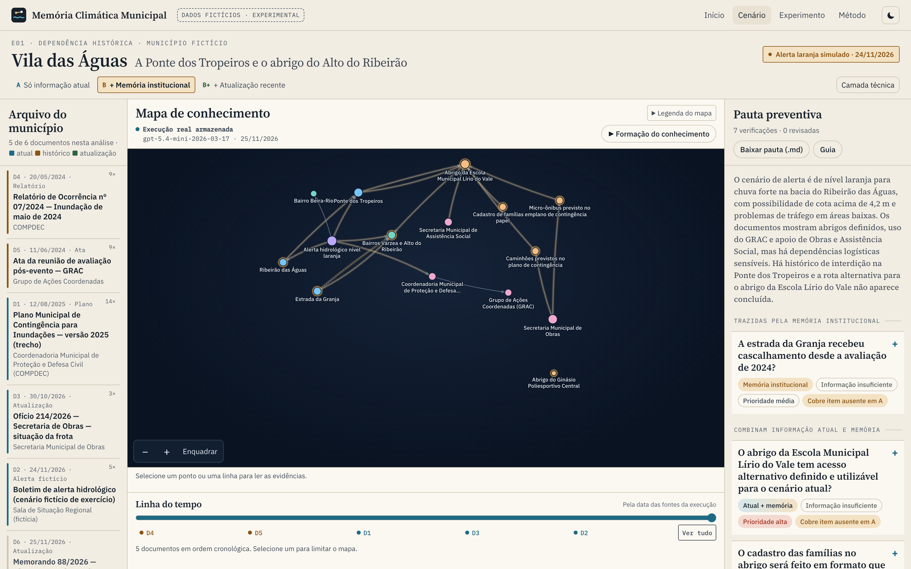
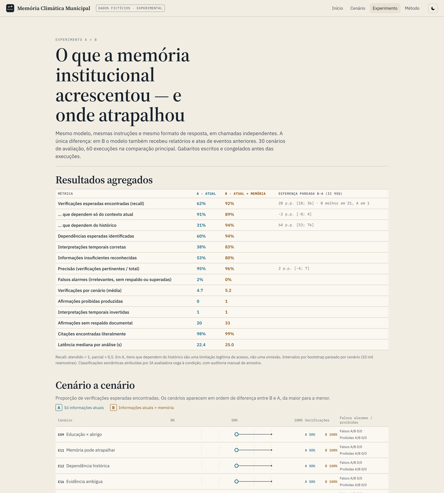

# Memória Climática Municipal (MCM)

**Protótipo experimental:** IA que lê documentos municipais dispersos — plano de contingência, alerta, ofícios, relatórios e atas de eventos anteriores — e monta uma **pauta de verificações preventivas** com as fontes à vista, para a equipe da prefeitura revisar antes de um evento de inundação.

> Todos os municípios, documentos, pessoas e alertas são **fictícios**. O MCM não emite alertas, não prevê desastres, não define níveis de risco nem recomenda evacuações. Ele sugere perguntas para revisão humana.



**Demonstração:** https://memoria-climatica-municipal.vercel.app · **Relatório de resultados:** [docs/resultados.md](docs/resultados.md) · **Diário de experimentação:** [docs/diario.md](docs/diario.md)

---

## O problema

Municípios que já passaram por inundações produzem conhecimento: relatórios de ocorrência, atas de avaliação, registros de falhas, recomendações. Esse conhecimento fica espalhado entre secretarias e se perde com a troca de gestão e de equipe. Quando chega um novo alerta, quem prepara a resposta nem sempre sabe que a ponte isolou o abrigo da última vez, que o gerador estava sem diesel ou que a lista de pessoas acamadas estava desatualizada.

Entre 1991 e 2024, 91,5% dos municípios brasileiros registraram ao menos um desastre ligado à água (Cemaden/USP/Inpe). A Lei nº 12.608/2012 atribui aos municípios a execução da política de proteção e defesa civil, e o plano de contingência é o instrumento central dessa preparação. Fontes em [docs/referencias.md](docs/referencias.md).

## A proposta

Transformar documentos dispersos em **conhecimento conectado e verificável**:

- **O que precisa ser confirmado?** Perguntas específicas, não um checklist genérico.
- **Por quê?** O que motivou cada pergunta, com o **trecho literal** e o documento de origem.
- **O que mudou com o tempo?** Problemas resolvidos, pendências antigas, responsáveis trocados, protocolos alterados, contradições.
- **O que não sabemos?** Informações que faltam e quem poderia confirmar (sujeito à confirmação institucional).

## A experiência

| Camada | Para quem | O que tem |
|---|---|---|
| Compreensão | quem nunca usou IA | contexto do município, guia de 4 passos, pauta em linguagem simples |
| Investigação | servidor, gestor | grafo de relações, linha do tempo, leitor com citações destacadas, comparação **só atual × com memória × com atualização** |
| Técnica | engenheiro, avaliador | modelo e id de cada chamada, documentos enviados, validação das citações, gabarito × resultado, métricas, prompts e schema |

A pauta é acionável: marcar como revisada, “precisa confirmar” ou “não se aplica”, anotar observações e **baixar a pauta em Markdown** para a reunião. A incorporação de atualizações aparece no modo **“+ Atualização recente”** do caso Vila das Águas: uma execução real em que a IA recebe um ofício novo sobre a rota alternativa. Na versão pública, a análise ao vivo fica desligada; rodando o projeto com chave própria, é possível escrever um documento novo e pedir outra análise.

Procedência sempre visível: **execução real armazenada** (modelo, data, id da chamada), **executada agora** ou **exemplo ilustrativo**.



## O papel da IA

Uma chamada por análise, com os documentos inteiros no contexto e **saída em JSON Schema estrito**: entidades, relações (com status epistêmico, período e evidências literais), achados temporais, verificações, informações ausentes e cautelas.

```
documentos fictícios ─► LLM (saída estruturada) ─► validação determinística ─► grafo + pauta ─► revisão humana
```

- O grafo é construído **a partir da saída do modelo**: nós e relações não são desenhados à mão. Sem GraphRAG, banco vetorial ou embeddings — o grafo não é usado para recuperar contexto.
- Validação determinística: documentos citados existem no conjunto enviado, trechos aparecem literalmente, relações apontam para entidades existentes.
- Modelo de análise: `gpt-5.4-mini-2026-03-17` (raciocínio `low`). Prompt: [prompts/analise_v2.md](prompts/analise_v2.md). Schema: [src/core/schema.ts](src/core/schema.ts).

## Metodologia experimental

**Hipótese:** com o contexto atual e a memória de eventos anteriores, a IA identifica dependências e verificações relevantes que passariam despercebidas só com as informações atuais. Também queríamos medir os riscos da memória: informação superada tratada como vigente, exagero, assunto fora do alerta.

- **Amostra:** 36 cenários fictícios (6 de desenvolvimento, 30 de avaliação final), 3 a 6 documentos cada. Em 11 dos 30, a memória foi desenhada para não ajudar ou poder atrapalhar. → [data/authoring](data/authoring)
- **Gabaritos** escritos antes das execuções e congelados com SHA-256 no commit `aea0272`; cada item marca se depende do contexto atual ou da memória. → [data/gold](data/gold)
- **Condições:** A = plano + alerta + informações atuais; B = A + registros históricos. Mesmo modelo, prompt, configuração e formato; chamadas independentes.
- **Avaliação:** validações determinísticas + rubrica aplicada por outro modelo (`gpt-5.4-2026-03-05`), cego à condição, com auditoria manual de amostra. → [prompts/avaliador_v1.md](prompts/avaliador_v1.md)
- **Execuções:** 60 da comparação principal + 40 repetições + 1 de atualização; 264 chamadas reais no total (incluindo a reexecução do E01 após renomeação), com respostas brutas em [runs/](runs).

## Resultados

| Nos 30 cenários | A · só atual | B · + memória |
|---|---:|---:|
| Verificações esperadas encontradas | 62% | 92% |
| … que dependem do histórico | 31% | 94% |
| … que dependem só do contexto atual | 91% | 89% |
| Precisão (pertinentes ÷ produzidas) | 95% | 96% |
| Citações literais | 98,2% | 99,2% |
| Afirmações proibidas (40 pontos de controle) | 0 | 1 |

Diferença pareada no recall: **+28 p.p.** (IC 95% +18 a +36). O ganho vem inteiro dos itens de memória; nos itens atuais não houve ganho. Casos de falha e limites: [docs/resultados.md](docs/resultados.md).

## Limitações

- Casos e gabaritos escritos pela mesma equipe, com apoio de IA; documentos curtos e limpos.
- Avaliação semântica automatizada; auditoria manual parcial e não cega; **sem validação por servidores ou especialistas em Defesa Civil**.
- Um único modelo de análise.
- O indicador de produtividade (TCPM) não foi medido; há protocolo proposto em [docs/resultados.md](docs/resultados.md) e na página Método do app.

## Metodologia simplificada para equipes

Exercício de oficina, sem programação e sem o aplicativo: [docs/guia-equipes.md](docs/guia-equipes.md).

## Como executar

Requisitos: Node 20+.

```bash
npm install
npm run dev            # app em http://localhost:5178 (usa public/data, execuções reais já gravadas)
```

Reproduzir o experimento (requer `OPENAI_API_KEY` em `.env`, nunca versionado):

```bash
npm run data:build                                             # separa cenários e gabaritos, recalcula hashes
npx tsx scripts/run-experiment.ts --tag meu_teste --split eval --conds A,B
npx tsx scripts/judge.ts --tag meu_teste
npx tsx scripts/score.ts --tag meu_teste
npx tsx scripts/build-app-data.ts --tag meu_teste --dev-tag dev_v2 --update-tag showcase_v1
```

Análise ao vivo na publicação: variáveis `OPENAI_API_KEY` e `MCM_LIVE_ENABLED=1` no servidor e `VITE_LIVE_ENABLED=1` no build (mostra o formulário); limites por visitante (`MCM_LIVE_PER_IP_HOUR`) e por dia (`MCM_LIVE_DAILY_CAP`).

## Estrutura

```
data/authoring/   cenários + gabaritos (fonte de autoria, YAML)
data/scenarios/   entrada do modelo (sem gabarito)
data/gold/        gabaritos + MANIFEST.json (hashes)
prompts/          instruções do analisador e do avaliador
src/core/         schema, montagem do prompt, cliente LLM, validação
src/web/          aplicação (React + Vite)
api/analyze.ts    análise ao vivo (função serverless)
scripts/          execução, avaliação, métricas, dados do app
runs/             respostas brutas de todas as chamadas
results/          métricas por execução, por item e resumo
docs/             diário, resultados, guia para equipes, referências
```

## Próximos passos

1. Testar com documentos reais anonimizados de 2 ou 3 municípios, com gabarito feito pela equipe municipal antes de ver a IA.
2. Medir o TCPM com servidores (pauta habitual × apoiada por IA, incluindo o tempo de conferir fontes).
3. Regras de revisão obrigatória para temas críticos (vigência de contratos, abrigos, rotas).
4. Registrar a decisão humana sobre cada verificação, para a memória melhorar a cada evento.
